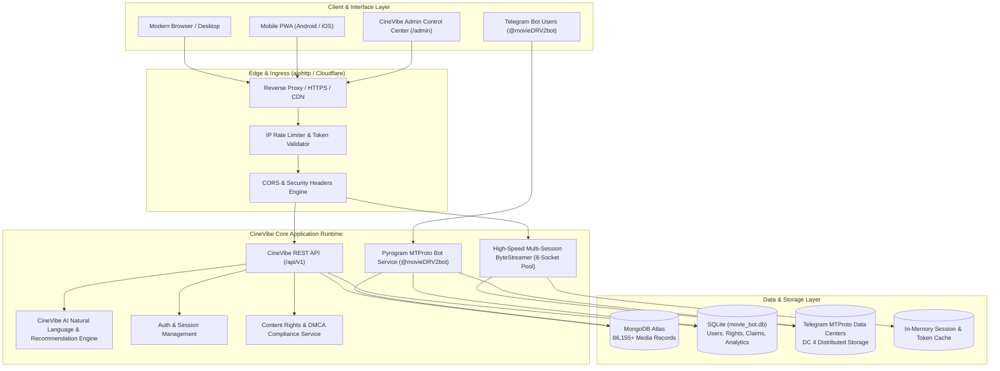

# CineVibe — System Architecture Specification
**Platform:** CineVibe — Your World of Cinema  
**Architecture Model:** Unified Asynchronous High-Throughput Media Platform  
**Target Availability:** 99.9%  

---

## 1. High-Level Architecture Overview

CineVibe combines high-concurrency Telegram media indexing, an 86,000+ title MongoDB document store, a high-speed multi-socket download streaming engine, an AI natural language discovery layer, and a cinematic responsive frontend.

---

## 2. Core Subsystems

### 2.1 CineVibe Web Application & UI/UX
- **Visual Aesthetic:** Deep cinematic black (`#080808`), `#121212` container cards, Golden Yellow (`#FFC928`) accents, subtle glassmorphism, responsive grid layouts.
- **Landing Experience:** Atmospheric hero section, animated ambient lighting, "EXPLORE CINEVIBE →" CTA, platform highlights.
- **Main Catalog:** Instant search with fuzzy typo-tolerance, horizontal trending carousel, category filters (4K, Bollywood, Hollywood, South Indian, Hindi Dubbed, Web Series, Documentaries, Anime), infinite scroll.
- **PWA Ready:** Web App Manifest and offline caching for metadata.

### 2.2 CineVibe REST API (`/api/v1`)
- Built directly into the asynchronous Python runtime (`aiohttp`).
- Endpoints for catalog querying, smart filtering, user auth/profile, watchlist, content requests, DMCA claims, and admin telemetry.
- Strict input validation, sanitized database queries, and structured JSON responses.

### 2.3 High-Speed Download Orchestrator
- **Multi-Socket Connection Pooling:** Maintains 8 concurrent MTProto TCP sockets per Telegram DC.
- **Hardware Acceleration:** Native `cryptg` (500+ MB/s AES-IGE) and OpenSSL `AES-CTR` (380+ MB/s) eliminate CPU bottlenecks.
- **Token Security:** Cryptographically random, single-use/expiring download tokens (`/download/{token}`) with IP-based rate limiting.
- **HTTP 206 Partial Content:** Range header support for video seeking in <0.5 seconds.

### 2.4 CineVibe AI Assistant & Discovery
- **Natural Language Parsing:** Converts queries like *"best Hindi thrillers 2024 in 4K"* into structured query filters (Language: Hindi, Genre: Thriller, Year: 2024, Resolution: 2160p).
- **Recommendation Engine:** Computes similarity vectors across genre, release era, and resolution.
- **Metadata Cleaner:** Automatically extracts clean titles, years, qualities, and codecs from messy torrent/release filenames.

### 2.5 Rights Verification & DMCA Compliance
- Formal authorization tracking for all distributed files.
- Automated public copyright claim form with immediate file suspension on validated complaints.
- Immutable audit log of all administrative rights decisions.

